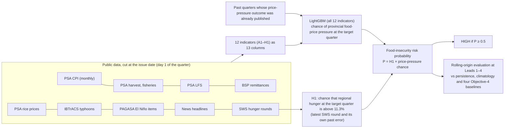

# E108 Deliverable B: revised methodology

**Status:** implemented and evaluated on branch `aiPHeed/e108-best-defensible-forecasting`. Not served on the dashboard.
**Rules:** `PROTOCOL.md` (sha `fc3e42f9…`, frozen 2026-10-25 03:18 UTC, before scoring).

## 1. The workflow

## 2. What the model predicts, and what each layer means

| Layer | What it is | What it is **not** |
|---|---|---|
| **Target (T43)** | Chapter I §1.7: a province-quarter is HIGH when Balance Luzon hunger is above 11.3% **and** its food prices are under pressure (food CPI YoY, or food − headline YoY, above the province's 2021–22 P60) | Not a measured share of food-insecure households. It is a composite risk proxy. |
| **H1 (hunger part)** | The served regional SWS outlook: the latest posted round plus the spread of its own past errors. One value for all five provinces. | Not learned. It cannot anticipate a hunger onset that the latest round does not show. |
| **LightGBM (price part)** | Probability of provincial food-price pressure (PS) at the target quarter, from all 12 indicators. Trained on past quarters whose PS outcome was published before the issue date. | Not a food-insecurity forecast by itself |
| **Risk probability** | P = H1 × price part. This follows the AND in the target definition and assumes the two conditions are independent given the inputs. | Not FIRI |
| **FIRI v2** | The served dashboard index, unchanged | Not an E108 output or input |
| **Municipal ranking** | Province probability disaggregated by fixed poverty and density weights (Objective 3) | Not an independent or validated municipal forecast |

**Why factor the target.** T43 is "hunger high AND price high". Between 2021-Q3 and 2023-Q3, 24 province-quarters had price pressure but low hunger, so they are labelled LOW. A single model trained directly on T43 (E107) learns that price pressure sometimes means LOW. Factoring lets LightGBM learn from all 115 price-pressure outcomes (52 HIGH) without that contradiction. The hunger part comes from the only observed food-insecurity measure. See `ROOT_CAUSE.md` V1.

## 3. Features

The 12 FIRI v2 indicator families enter as 13 columns:
- A1 contributes 2 (projected food YoY and projected food − headline YoY, each minus the province threshold);
- every other family contributes 1.

Full registry: `INDICATOR_AUDIT.md`.

Four families repeat one value across provinces (C1, E1, E2, H1). They can shift risk for the whole region but cannot tell provinces apart.

## 4. Training

At every issue date:
- **Training rows:** every (past origin *t*′, province) whose target quarter *t*′ + *k* ends before the issue date and whose CPI quarter was complete.
- **Model:** LightGBM with depth 1 or 2, 50 or 150 trees, learning rate 0.05, L2 = 5, class weight none or balanced.
- **Minimum leaf of 15 rows,** that is, three quarters of five provinces. A national value can therefore never isolate one or two quarters.
- **Selection:** 1 of 8 settings, by log loss on the last four training quarters, each predicted from earlier quarters only.
- No feature selection, no calibration, threshold 0.5.

## 5. Horizon evaluation and the maximum reliable lead

- **Leads tested:** Lead *k* = 1, 2, 3 and 4 quarters ahead. Longer leads leave fewer than 6 evaluable quarters.
- **Rolling origin:** each forecast is compared with the T43 label observed later.
- **Inference is by quarter.** Provinces of one quarter share one hunger value and are not independent outcomes.
- **Reliable** means passing every criterion in `PROTOCOL.md` §7:
  - E107's R1–R7 and G1–G3, unchanged;
  - plus G4: the result must also hold on the hunger-elevated quarters, where risk depends on prices.
- **Inconclusive:** the point criteria pass but significance or the recent-period check does not, or the evidence is too small.
- **Maximum reliable lead** = the longest *k* such that Leads 1..*k* are all reliable. It is reported separately from the longest lead tested.

## 6. How DA personnel should read a forecast

1. P is the estimated chance that the province meets the Chapter I high-risk condition in the target quarter. It is not the share of households that are food insecure.
2. **The regional part dominates timing.** If the latest SWS round is near or below 11.3%, P cannot exceed about 0.5. A hunger surge that has not yet appeared in a published SWS round cannot be forecast.
3. **The provincial part comes almost entirely from food-price inputs** (section 4 of `MODEL_COMPARISON.md`). National inputs (jobs, remittances, El Niño status) move every province together.
4. Treat a HIGH forecast as a reason to check official PSA, DA and DSWD data and field reports. It is not a replacement for them.
