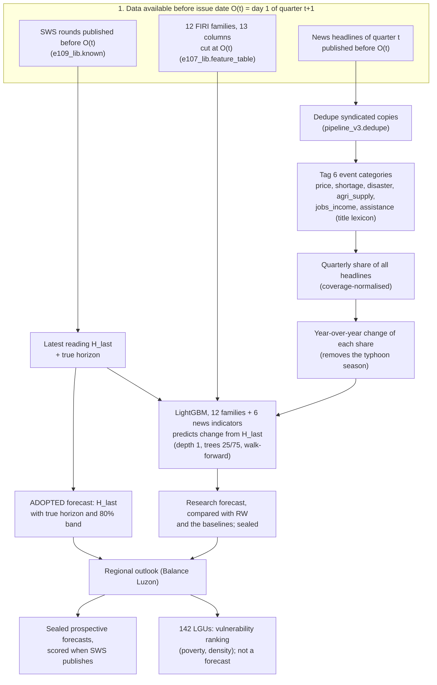

# E112 Final aiPHeed methodology

## One-line summary

aiPHeed forecasts **SWS experienced hunger for Balance Luzon** (the only measured food-insecurity series available) from information published before each issue date.
- **The adopted forecast** is the latest published reading, labelled with its true horizon and its empirical error.
- **The 12-family LightGBM, with and without news indicators, is run beside it as the research model.** It is reported, compared with the baselines and sealed, but not adopted, because it does not beat the latest reading under the frozen rules.
- **Municipal outputs are vulnerability rankings**, not forecasts.

## Diagram (matches `runner/` code)

## Steps

| Step | What | Code |
|---|---|---|
| 1. Issue date | O(t) = first day of quarter t+1. Only information published before O(t) is used. | `e107_lib.issue` |
| 2. Outcome vintage | SWS BL rounds published before O(t). The newest is usually quarter t−1, so Lead k has true horizon k+1. | `e109_lib.known`, `h_last` |
| 3. Indicators | 12 FIRI families (13 columns), provincial values averaged to the region | `e109_lib.regional_features` |
| 4. News | De-duplicated headlines, six categories, share of all headlines, YoY change. Quarter t is used at O(t) only if its last headline precedes O(t). | `news_indicators.py`, `e112_lib.news_at` |
| 5. Model | LightGBM predicting the change from the latest reading. Fixed E109 settings; walk-forward training on pairs whose target was published before O(t). | `e112_lib.lgbm_forecast` |
| 6. Comparison | Every forecast is compared with RW, MA2, MEAN, SEAS, LL, news-only, PSA-only and linear regression on the same rows, under the frozen P1–P8 rule | `run_e112.py score`, `obj4` |
| 7. Decision | Adopt the first "provisional" research model; otherwise adopt RW. **Result: RW.** | `run_e112.py` (PROTOCOL §5) |
| 8. Communication | Regional outlook + true horizon + empirical error (about 3.7 points at Lead 1). LGU table = vulnerability ranking, labelled as such. | API `/api/v1/e112/*` (read-only) |
| 9. Prospective check | Sealed forecasts are scored when SWS publishes | `score_prospective.py` |

## Why this is simple

- **One outcome** (SWS BL hunger, continuous): no composite targets, no thresholds.
- **One adopted rule** (the latest reading) and **one research model** (LightGBM) with a fixed configuration and no tuning loops.
- **One news representation** (six category shares and their YoY change) that anyone can recompute from headlines.
- **One evaluation rule** (P1–P8), frozen before scoring.

## What the methodology deliberately does not do

- **No provincial or municipal food-insecurity forecasts:** there is no outcome to train on or validate against.
- **No claim of a reliable lead time:** none is established.
- **No use of news published after the issue date:** asserted in code (`e112_lib._news_at`) and tested (`test_e112.py`).
