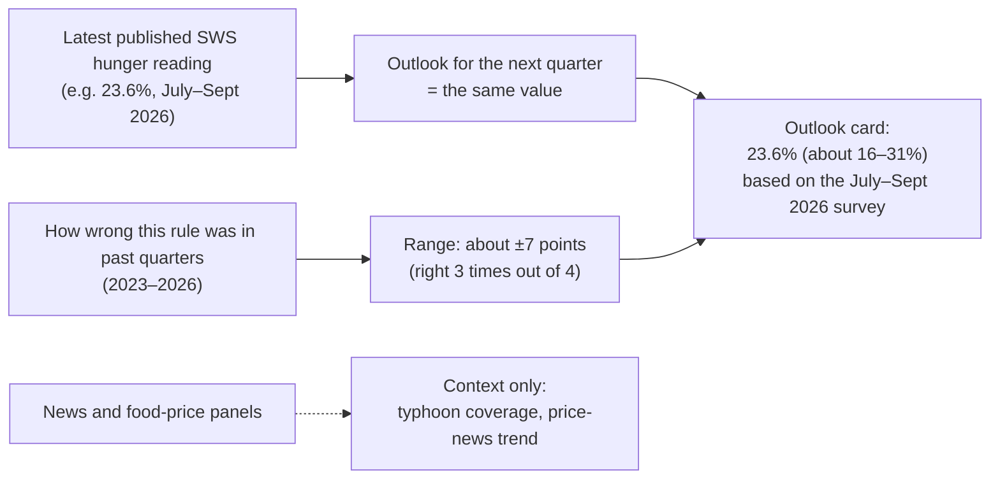

# aiPHeed hunger outlook: one-page summary for DA IV-A

## What it does

aiPHeed tells you **where hunger in Balance Luzon (which includes CALABARZON) stood at the latest Social Weather Stations (SWS) survey**, and **how much it could change by the quarter you are planning for**.

## Why the rule is "the latest reading"

We tested more than ten ways of predicting the next SWS reading, on four survey areas and fourteen quarters:
- news about disasters, supply, prices and relief;
- food inflation and rice prices;
- trends and averages;
- statistical and machine-learning models.

**None did better than simply carrying the latest reading forward.** So aiPHeed does not pretend to know which way hunger will move.

## How to read an outlook

- **The number** is the latest SWS reading, with the survey quarter it came from.
- **The range** contained the actual next reading about **3 times out of 4** in the past. Beyond one quarter ahead the range is less reliable.
- **"True horizon"** tells you how many quarters separate the survey from the quarter being planned for. SWS results come out after each quarter ends, so update the outlook as soon as a new SWS result is released.

## What it cannot do

- It **cannot warn of a sudden rise in hunger.** The 2024 rise was missed by every method.
- It **does not give province, city or municipal hunger levels.** No such data exist yet. The municipal table is a ranking of **vulnerability** (poverty and population density), not of measured hunger.
- **News and food prices are shown for context**, not as hunger predictors:
  - disaster news closely follows typhoons;
  - rising price news has come about two quarters before food prices sped up.

## What would make it better

- New SWS results from late 2026 onward, to check the sealed forecasts.
- The 2024 CBMS food-security results for each city and municipality.
- Provincial food-insecurity data from FNRI.
