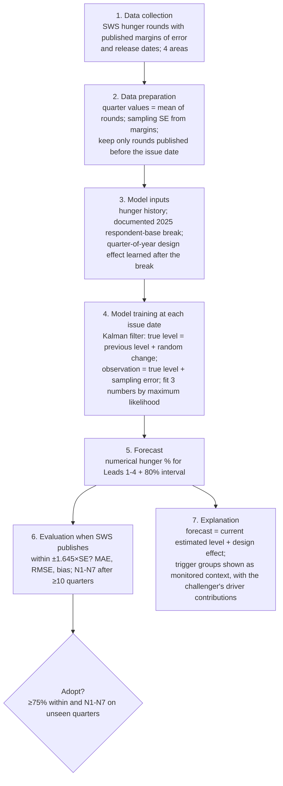

# AIPHEED E136 · Independent methodology review and recommended methodology

**Evidence status.**
- Protocol `f12ea6b` was frozen before any E136 computation.
- All 2021-Q2 … 2026-Q3 SWS values had been seen, so every number here is **development evidence** from chronological walk-forward (expanding window, refit at every issue, only data published before the issue).
- Production, the dashboard, the API, FIRI, the served forecasts and every earlier seal are unchanged.
- Window: 2021+ (owner decision, E134 Addendum 1).

**Reproduce.** E135 `runner/e135_run.py` first, then:
```
python -I runner/e136_run.py      # about 1 minute
python -I runner/e136_seal.py     # write-once; already written
```
Outputs: `out/e136_metrics.csv`, `out/e136_rules.json`, `out/e136_recommendation_table.csv`, `out/e136_summary.json`.

---

## A. Executive decision

**What prevents AIPHEED from succeeding.**
- **The main obstacle is the information content of the target relative to its tolerance. It is not the learning algorithm.**
  - The SWS hunger level really changes by about 4.6 points (SD) over the Lead-2 horizon, while the tolerance is about ±3.2 points.
  - A forecaster that knew today's true hunger level exactly would still be within tolerance only about 54 % of the time at Lead 2.
  - Reaching 75 % requires predicting about **74 %** of the true change three quarters ahead (E133 D1).
- **The 2021–2026 window contains one shock episode** (the 2024 surge) and one survey redesign (2025). No feature can learn the size of a shock from a single example (E134 event analysis).
- **Sampling noise is not the problem:** it is only 8–15 % of the forecast error (E134).
- **Geographic mismatch is a limit on the claim, not on accuracy.** The target covers 4 broad areas; CALABARZON is 1 of 7 regions in Balance Luzon.

**Is 75 % realistic with this data?** **No, not at Lead 2 with the 2021+ observations.** No model in E131–E136 exceeds 0.61 on any set at Lead 2. The bound in D1 shows why. A realistic path needs the information listed in §F, plus unseen quarters for confirmation.

**Retain:**
- SWS involuntary hunger as the quarterly target;
- the frozen tolerance and N1–N7;
- strict publication-date (point-in-time) rules;
- chronological validation;
- measurement-aware state-space modelling, which every comparison favours over learned models;
- the provincial layer kept separate and labelled model-based.

**Abandon:**
- LightGBM and ridge as forecasting engines. They overfit (training MAE 2.1 against out-of-sample 6.3/7.4) and lose to persistence.
- Treating all five trigger groups as forecast drivers by default.
- Adaptive "learn whom to trust" weighting (E135: it fails).
- Adding more indicators in the hope of a gain (E134: more inputs make it worse).
- Any claim of quarterly *provincial* forecasting.

**Recommended methodology** (frozen E136 rule): **SEAS-LLM**, a measurement-aware seasonal local-level model of SWS hunger, with three parameters and no learned trigger weights. **SIMPLE** (the same kind of model plus three evidence-backed drivers) is the registered challenger. Details and the honest caveats are in §G.

## B. Methodology comparison (Lead 2, P-DASH)

**Sets:**
- **S-U:** 40 rows, 10 quarters, 2024-Q1 … 2026-Q3 (includes the surge).
- **S-E132:** 28 rows, 7 quarters, 2024-Q4 … 2026-Q3.

| Approach | What it is | Parameters | Data needs | S-U within / MAE | S-E132 within / MAE | Advantages | Disadvantages |
|---|---|---|---|---|---|---|---|
| A PERSIST | Latest SWS value | 0 | SWS | 0.40 / 5.98 | 0.46 / 5.28 | Trivial, honest floor | Misses every change |
| B TREND-D | Latest + ½ × last change | 0 | SWS | 0.30 / 7.17 | 0.32 / 7.10 | Simple | **Worse than persistence**: recent changes do not continue |
| C RIDGE-ALL | Ridge on history + 5 groups | ≈ 23 | All groups | — / — | 0.39 / 7.36 | Simple learned model | Overfits (training 2.08 vs out-of-sample 7.36); worse than persistence |
| D LGBM-ALL | LightGBM on history + 5 groups | ≈ 100 trees | All groups | — / — | 0.36 / 6.30 | Nonlinear | Overfits (2.12 vs 6.30); worse than persistence |
| E SEAS-LLM | Measurement-aware level + 2025 break + shrunk quarter effect | 3 | SWS + margins | 0.45 / 5.72 | **0.61** / 4.78 | Simplest eligible; best after the 2025 break | Misses surges (3/16); S-U coverage 0.55 |
| HFM-X | Pooled 4-area level + 5 driver groups | 10 | SWS + 5 groups | **0.50** / 4.87 | 0.43 / 4.96 | Best in the 2024 surge (8/16 caught) | Worst post-break; less stable (see §D) |
| X-RED | HFM-X with half the prior scale | 10 | Same | 0.475 / 4.79 | 0.54 / 4.35 | Balanced | Chosen after seeing data (E135) |
| **SIMPLE** | Pooled level + rice, unemployment, news (prior 0.5) | 8 | SWS + 3 series | 0.475 / **4.75** | 0.54 / **4.25** | Lowest MAE on both sets; most stable | Feature set chosen with hindsight; surge 3/16 |

Ridge and LightGBM need at least 20 training rows, so they exist only on S-E132.

## C. Recommended methodology, step by step



**Plain-language description.**
1. **Data collection.** Every SWS hunger survey round for Metro Manila, Balance Luzon, Visayas and Mindanao since 2021, with its published margin of error and release date.
2. **Data preparation.**
   - Average the rounds within each quarter.
   - Convert each margin of error into a standard error (the size of the sampling noise).
   - When forecasting on a given day, use only rounds already published that day.
3. **Inputs.**
   - Only the hunger history.
   - The 2025 change of respondents (household heads → adults) is documented by SWS, so it is entered as a known break.
   - After the break, a small quarter-of-year effect is learned from past data and shrunk toward zero.
4. **Training.** A Kalman filter separates the true hunger level from survey noise. It estimates how much the true level moves per quarter and how big the break was. This is three numbers, re-estimated each quarter from past data only.
5. **Forecast.** The best estimate of today's true level, plus the quarter effect for the target quarter. The interval widens with the horizon.
6. **Evaluation.** When SWS publishes the target quarter, check whether |forecast − SWS| ≤ 1.645 × SE. After 10 or more quarters, apply N1–N7.
7. **Explanation.**
   - The forecast is explained as "where hunger is now, after removing survey noise, plus the seasonal pattern of the new survey design".
   - The five trigger groups are reported **as context**: current market, climate, employment, news and vulnerability conditions.
   - The challenger SIMPLE shows how much rice prices, unemployment and shortage news would move the forecast.
   - The report keeps **predictive evidence** (measured in validation) separate from **context** (not shown to improve forecasts).

## D. Experiment results

**Leads 1–4, P-DASH.**
- Rows: S-U 44 / 40 / 36 / 32; S-E132 36 / 28 / 24 / 20.
- Sources: `out/e136_metrics.csv`, `out/e136_rules.json`.

**Within tolerance (S-U | S-E132):**

| Model | L1 | L2 | L3 | L4 |
|---|---|---|---|---|
| PERSIST | 0.48 \| 0.44 | 0.40 \| 0.46 | 0.36 \| 0.54 | 0.38 \| 0.50 |
| TREND-D | 0.41 \| 0.39 | 0.30 \| 0.32 | 0.42 \| 0.54 | 0.41 \| 0.45 |
| RIDGE-ALL | — \| 0.39 | — \| 0.39 | — \| 0.33 | — \| 0.15 |
| LGBM-ALL | — \| 0.33 | — \| 0.36 | — \| 0.42 | — \| 0.15 |
| SEAS-LLM | 0.39 \| 0.36 | 0.45 \| **0.61** | 0.33 \| 0.50 | 0.44 \| **0.65** |
| HFM-X | 0.55 \| 0.50 | **0.50** \| 0.43 | 0.50 \| 0.50 | 0.31 \| 0.25 |
| X-RED | 0.57 \| 0.56 | 0.475 \| 0.54 | 0.47 \| 0.62 | 0.44 \| 0.50 |
| SIMPLE | 0.57 \| 0.56 | 0.475 \| 0.54 | 0.44 \| 0.58 | 0.41 \| 0.50 |

**MAE (S-U | S-E132):**

| Model | L1 | L2 | L3 | L4 |
|---|---|---|---|---|
| PERSIST | 5.05 \| 5.38 | 5.98 \| 5.28 | 6.46 \| 4.04 | 6.51 \| 3.77 |
| SEAS-LLM | 5.49 \| 5.97 | 5.72 \| 4.78 | 6.23 \| 3.53 | 6.30 \| 3.16 |
| HFM-X | 4.70 \| 5.25 | 4.87 \| 4.96 | 5.10 \| 4.84 | 5.51 \| 6.11 |
| SIMPLE | **4.35** \| **4.74** | **4.75** \| **4.25** | 5.05 \| 3.52 | 5.49 \| 4.18 |

**Lead 2 detail:**

| Model | Set | RMSE | Bias | High-tercile bias | Sharp increases within | 80 % coverage | Failed rules |
|---|---|---|---|---|---|---|---|
| SEAS-LLM | S-U | 7.58 | −3.19 | −7.64 | 3 / 16 | 0.55 | N2, N3, N4, N5, N6, N7 |
| SEAS-LLM | S-E132 | 6.53 | −1.16 | −6.68 | 3 / 7 | 0.71 | N1, N2, N4, N5, N6 |
| HFM-X | S-U | 6.42 | −2.53 | −7.14 | 8 / 16 | 0.75 | N2, N5 |
| SIMPLE | S-U | 6.15 | −2.98 | −7.29 | 3 / 16 | 0.80 | N2, N5 |
| SIMPLE | S-E132 | 5.55 | −2.02 | −6.59 | 1 / 7 | 0.86 | N1, N2, N5, N6 |

**Reliability.**
- **No candidate passes N1–N7 at any lead on any set. Maximum reliable lead: none.**
- **Lead 2 fails because:**
  - agreement is at most 0.61, below the 0.75 required (N2);
  - accuracy is unstable across thirds of the period (N5);
  - S-E132 has only 7 quarters (N1).

**Overfitting:**
- Ridge and LightGBM: training MAE 2.08 / 2.12 against out-of-sample 7.36 / 6.30 at Lead 2.
- The state-space models (3–10 parameters) have the lowest out-of-sample errors.

**Stability.** Moving the training start from 2021-Q2 to 2022-Q1 changes the forecasts by these mean absolute amounts:

| Model | L1 | L2 | L3 | L4 |
|---|---|---|---|---|
| SIMPLE | 0.43 | 0.45 | 0.42 | 0.55 |
| HFM-X | 0.67 | 0.88 | 1.05 | 1.72 |

SIMPLE's coefficients are steady across origins: A 0.15 → 0.46, E 0.14–0.33, N 0–0.16.

**Generalization.** By period (Lead 2):

| Model | Surge 2024 | Post-break 2025+ |
|---|---|---|
| SEAS-LLM | 0.06 | 0.71 |
| HFM-X | 0.56 | 0.46 |
| SIMPLE | 0.31 | 0.58 |

- **By area:** every model is weakest in Visayas and Mindanao.
- **Provincial generalization cannot be claimed:** there is no provincial target.

**Bias.** High-hunger under-prediction of −6.6 to −7.6 remains in every model. About 2 points of it are irreducible sampling selection; the rest is lag behind true change.

## E. Feature decisions

| Group / feature | Decision | Plain-language reason |
|---|---|---|
| H1 hunger history (with survey noise removed) | **Retain** | The only signal that helps every model at every lead |
| A rice price change | **Requires further evidence** (in the challenger) | Helped warn of the 2024 surge, but misled in 2025–26 when prices fell and hunger rose |
| A other price measures (food inflation, bottom-30 % CPI) | **Remove** as drivers | Redundant with rice. They did not improve accuracy (E132–E133). |
| C typhoon count | **Remove** | Weak and often out of date; removing it improved errors |
| C ONI / El Niño | **Requires further evidence** | Led the 2024 surge, but only one episode; registered for a prospective test (E134-ONI) |
| C area rainfall deficit | **Retain only for Lead 4** (hypothesis) | Helped only at the longest lead |
| C3 palay production | **Remove** | Made forecasts worse at Leads 2–3 |
| E unemployment change | **Requires further evidence** (in the challenger) | Showed value at Leads 2 and 4 in one model, but not in another |
| E remittances, regional pay | **Contextual information only** | Annual or national; no forecast gain |
| N shortage news (GDELT) | **Requires further evidence** (in the challenger) | A small, consistent effect |
| N FSSI (provincial news) | **Contextual information only** | Covers 5 of Balance Luzon's provinces; no signal |
| V poverty, vulnerability | **Contextual information only** | Changes every 3 years; no forecast effect; useful for the provincial layer |

**These decisions come from E133–E135 ablations on the same development data.** They are hindsight, so they are confirmed only prospectively. "Remove" means "not used as a forecast driver"; the data still appear as context.

## F. Smallest set of additional data that could matter

| Dataset | Source | Geography / frequency | Status | Problem it addresses | Realistic contribution |
|---|---|---|---|---|---|
| Future SWS quarters (2026-Q4 onward) | SWS releases | 4 areas, quarterly | Arriving; sealed forecasts exist | Confirmation (N1) and more episodes | Required for any claim. 10 Lead-2 quarters bring the earliest decision to 2029-Q3. |
| Regional LFS quarterly (employment, underemployment, hours) | PSA LFS releases | Region, quarterly | Available in release documents; needs manual extraction with release dates | Income loss behind escalations | The best chance of a real Lead-2 driver; untested |
| CBMS 2024 FIES | PSA / LGUs | LGU, one round | Needs an official request | Provincial validation | Validates provincial estimates (cross-section), not forecasts |
| Household coping and finance (borrowing, meal skipping, savings) | FNRI / SWS / BSP | Region or national; periodic | Request or extraction; not checked | Escalation size | Uncertain; untested |
| Dated disaster-impact counts | NDRRMC | Province, event | PDF reports; manual coding | Local shocks | Uncertain; untested |

**Not recommended:** more price or production series (redundant or harmful) and more algorithms. Pre-2021 data was declined by the owner.

## G. Final recommendation

**Recommended methodology: SEAS-LLM**, selected by the frozen E136 rule.

**Reasons:**
- **Eligible:** it beats persistence on Lead-2 MAE on both sets.
- **Rank:** it ties with SIMPLE, X-RED and HFM-X on mean within-rank (2.5).
- **Tie-break:** it is the simplest (3 parameters).
- **Rule 5 keeps the simpler model:** SIMPLE does not beat it on both sets (S-E132: 0.54 against 0.61).
- **Easiest to explain and maintain:** it uses only the target series and documented survey facts.
- **Consistent with the evidence** that no trigger group yet has a robust Lead-2 contribution.

**Remaining uncertainty, stated plainly:**
- **The choice rests on an exact four-way tie.** SIMPLE has lower MAE and RMSE on both sets, better 80 % coverage, and fails fewer rules (S-U: N2 and N5 only, against six for SEAS-LLM). SEAS-LLM wins only on S-E132 agreement and in the post-break regime, and it misses surges.
- I have **not** overridden the rule after seeing this. Doing so would be result-driven.
- **SIMPLE** is registered as the challenger. Its forecasts are sealed (`sealed/E136_PROSPECTIVE_SEAL.csv`, sha256 `9bccb2ec…`), together with **X-RED** as a separate prospective hypothesis. At this issue X-RED shrinks typhoons and poverty to exactly 0, so its sealed forecasts equal SIMPLE's to within 0.0001.

**Neither replaces HFM-X silently.**
- **HFM-X** remains the E134 frozen prospective candidate.
- **Making SEAS-LLM the primary** requires your approval of an amendment to the E134 prospective protocol.

**The thesis claim this design supports:**
- *forecasting measured hunger for the SWS areas that contain CALABARZON* (Balance Luzon), with a separate, labelled, model-based provincial layer validated only at PSA survey rounds;
- *not* quarterly provincial food-insecurity forecasting.

**Target alternatives considered:**

| Alternative | Status | Reason |
|---|---|---|
| Keep SWS and limit the claim to its geography | **Recommended** | Preserves the objective's construct |
| Separate provincial validation track (PFDR, FIES, FNRI, CBMS) | **Recommended alongside** | Provides validation at survey rounds |
| A new quarterly provincial target | Unavailable | No such measurement exists |
| Redefining the objective around the provincial ordering | Not recommended | It is measure-dependent (E134) |

**Separate protocol concern (no change made).**
- The tolerance counts only sampling error (±1.645 × SE ≈ ±3.2), while true quarter-to-quarter change is larger.
- E131 Addendum 1 (owner) keeps the primary criterion only, and E136 does not change it.
- **Any change would require your explicit approval.**

## H. Implementation plan (nothing integrated)

**Research and data**
1. Score the E131–E136 seals when SWS publishes 2026-Q4 (around January 2027). Add the rounds to `E131_Objectives_Resolution/data/sws_rounds_after_2026Q3.csv` and run each `score_*.py`.
2. Extract regional quarterly LFS (unemployment, underemployment) with release dates.
3. Request CBMS 2024 FIES (owner decision).

**Model development**
4. If approved, amend the E134 prospective protocol to make SEAS-LLM primary, with SIMPLE and HFM-X as challengers. Freeze before 2027-01-01.
5. Test regional LFS as a driver in a new frozen protocol: development first, then prospective.

**Validation**
6. Quarterly re-issue (`E134 runner/e134_reissue.py` pattern) for the primary and the challengers, write-once.
7. Apply N1–N7 after 10 unseen Lead-2 quarters (2029-Q3 at the earliest).

**Dashboard integration (only after validation)**
8. Show the SWS-area forecast with its interval. Show trigger groups as context, and provincial values labelled model-based.
9. Integrate on a separate branch, after owner approval.
