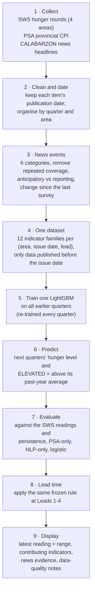

# The final methodology, in simple terms

## Workflow



**Plain-text version:**

`collect` → `clean and date` → `news events` → `one dataset (12 families)` → `train LightGBM` → `predict` → `evaluate against SWS and baselines` → `lead-time rule` → `display`

## Each step and the code that does it

| Step | What happens | Code |
|---|---|---|
| 1. Collect | <ul><li>SWS Total Hunger for NCR, Balance Luzon, Visayas and Mindanao, 2021–2026: 23 rounds with their publication dates.</li><li>PSA provincial food and all-items CPI.</li><li>About 9,700 CALABARZON news headlines with publication dates.</li></ul> | `data/` (`data_sources.csv` lists every file and its hash) |
| 2. Clean and date | Each value is stored with the date it became public. A forecast issued on date O may only use values published before O. | `fi_lib.known`, `fi_lib.row_features` |
| 3. News events | <ol><li>Tag each headline with 6 categories: price, shortage, disaster, agriculture/supply, jobs/income, assistance.</li><li>Drop repeated stories about the same event.</li><li>Mark forward-looking headlines.</li><li>Measure how each category's share changed since the last survey, compared with a year earlier.</li></ol> | `news_features.py` |
| 4. One dataset | For every area, issue date and lead (1–4 quarters), combine the 12 families: food prices, headline inflation, rice, poverty, El Niño, typhoons, crop and fish production, unemployment, remittances, news, and hunger history. | `fi_lib.panel` |
| 5. Train LightGBM | One model is fitted at each issue date on all earlier rows whose outcome was already published. Its size is chosen from 4 settings by checking the most recent earlier quarters. | `fi_lib.fil_forecasts` |
| 6. Predict | <ul><li>The model predicts how far hunger will be from the area's past-year average.</li><li>That gives a hunger level, and ELEVATED (yes/no) with a probability.</li></ul> | same |
| 7. Evaluate | <ul><li>Accuracy, balanced accuracy, precision, recall, F1, AUC, Brier and MAE.</li><li>Compared with persistence (the latest reading), PSA-only, NLP-only and logistic regression on the same rows.</li><li>Leakage is checked by changing future data and confirming that no forecast changes.</li></ul> | `fi_lib.decide`, `run_final.py audit/score` |
| 8. Lead time | One frozen rule at every lead (accuracy ≥ 0.75 plus 7 checks). The furthest lead that passes is the maximum reliable lead. | `fi_lib.max_reliable_lead` |
| 9. Display | <ul><li>The latest SWS reading per area, its age and its typical error range.</li><li>The PSA food-price squeeze per province.</li><li>The news since the last survey.</li><li>The data-quality notes.</li></ul> | Dashboard (unchanged in this run) |

**Rerun everything with one command**

```bash
python run_final.py all
```

Run it from `runner/`, using the backend venv. It runs these phases in order:
1. `data`
2. `audit`
3. `score`
4. `long`
5. `news`
6. `psa`
7. `general`
8. `addendum1`
9. `addendum2`
10. `seal`

**Test:** `backend/tests/unit/test_final_fi_lgbm.py`.

## What the evaluation found (one paragraph for Chapter IV)

> Food insecurity was measured with the SWS involuntary hunger rate for four areas, Balance Luzon (which contains CALABARZON) and three comparison areas. A quarter was classed as ELEVATED when hunger exceeded the area's average over the previous four quarters. One LightGBM model combining all twelve indicator families, including dated news indicators, was retrained each quarter and tested walk-forward from 2023 to 2026. It reached 32–50% accuracy at one to four quarters ahead, below the latest-reading baseline (61% at one quarter). The same method trained on SWS data from 1998 and tested on 70 untouched quarters (2003–2020) reached 50–55%. A simulation of a forecaster that knows the hunger process exactly shows that no method can exceed about 58–64% one quarter ahead for this outcome, because hunger changes are driven by new shocks and survey sampling noise. The 75% accuracy target and a reliable forecasting lead time were therefore not achievable with SWS regional data. News indicators tracked concurrent hunger, but did not improve forecasts.

## Why this is simple

| Choice | Detail |
|---|---|
| One model | LightGBM, retrained each quarter |
| One label | ELEVATED |
| One time rule | Only data published before the issue date |
| One reliability rule | The same rule at every lead |
| Excluded | Ensembles, stacking and multi-stage pipelines |
| Baselines | The simplest possible alternatives |
