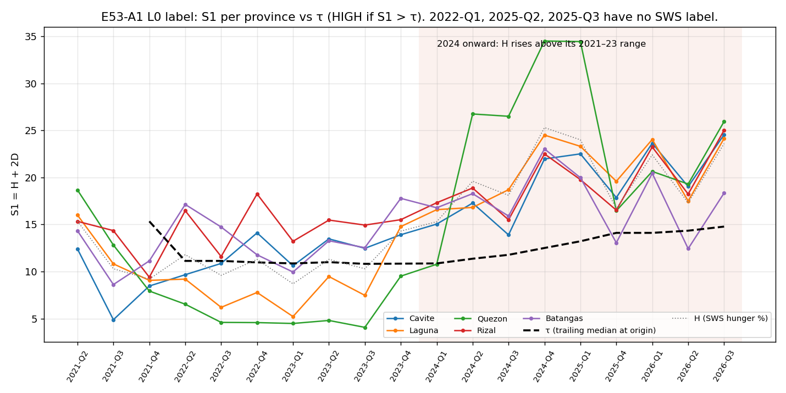

# Label audit: E53-A1 L0 label (read-only)

S1 = H + 2D. H = mean of the quarter's definition-A SWS rounds (Luzon hunger %). D = provincial food CPI YoY minus the five-province mean (`d_quarterly_panel.csv`). τ = median of the pooled S1 of all quarters 2021-Q1..t-1 whose SWS rounds were all posted before the lead-1 origin (the served rule). HIGH if S1 > τ.

## Checks

- S1 = H + 2D recomputed from the raw files: max abs error 3.55e-15 over 95 rows.
- D = F − mean F (sign and centring): max abs error 2.00e-15; the five D values sum to 6.25e-15 at most.
- τ recomputed independently: max abs error 0.00e+00.
- label matches the engine's `label()`: 95/95.
- τ is not stale: it grows by one quarter's posting at each origin (columns n and last quarter in τ).

## CALABARZON per quarter

| Quarter | Origin | H | highest earlier H | mean S1 | τ | quarters in τ (last) | D spread | provinces HIGH |
|---|---|---|---|---|---|---|---|---|
| 2021-Q2 | 2021-04-01 | 15.35 | – | 15.35 | – | 0 (–) | 3.13 | 0/5 |
| 2021-Q3 | 2021-07-01 | 10.30 | 15.35 | 10.30 | – | 0 (–) | 4.73 | 0/5 |
| 2021-Q4 | 2021-10-01 | 9.20 | 15.35 | 9.20 | 15.34 | 1 (2021-Q2) | 1.60 | 0/5 |
| 2022-Q2 | 2022-04-01 | 11.80 | 15.35 | 11.80 | 11.13 | 3 (2021-Q4) | 5.30 | 2/5 |
| 2022-Q3 | 2022-07-01 | 9.60 | 15.35 | 9.60 | 11.13 | 3 (2021-Q4) | 5.07 | 2/5 |
| 2022-Q4 | 2022-10-01 | 11.30 | 15.35 | 11.30 | 10.98 | 4 (2022-Q2) | 6.83 | 3/5 |
| 2023-Q1 | 2023-01-01 | 8.70 | 15.35 | 8.70 | 10.87 | 5 (2022-Q3) | 4.37 | 1/5 |
| 2023-Q2 | 2023-04-01 | 11.30 | 15.35 | 11.30 | 11.00 | 6 (2022-Q4) | 5.33 | 3/5 |
| 2023-Q3 | 2023-07-01 | 10.30 | 15.35 | 10.30 | 10.82 | 7 (2023-Q1) | 5.43 | 3/5 |
| 2023-Q4 | 2023-10-01 | 14.30 | 15.35 | 14.30 | 10.84 | 8 (2023-Q2) | 4.13 | 4/5 |
| 2024-Q1 | 2024-01-01 | 15.30 | 15.35 | 15.30 | 10.87 | 9 (2023-Q3) | 3.27 | 4/5 |
| 2024-Q2 | 2024-04-01 | 19.60 | 15.35 | 19.60 | 11.37 | 10 (2023-Q4) | 4.97 | 5/5 |
| 2024-Q3 | 2024-07-01 | 18.10 | 19.60 | 18.10 | 11.78 | 11 (2024-Q1) | 6.30 | 5/5 |
| 2024-Q4 | 2024-10-01 | 25.30 | 19.60 | 25.30 | 12.51 | 12 (2024-Q2) | 6.27 | 5/5 |
| 2025-Q1 | 2025-01-01 | 24.00 | 25.30 | 24.00 | 13.22 | 13 (2024-Q3) | 7.33 | 5/5 |
| 2025-Q4 | 2025-10-01 | 16.70 | 25.30 | 16.70 | 14.11 | 15 (2025-Q1) | 3.27 | 4/5 |
| 2026-Q1 | 2026-01-01 | 22.40 | 25.30 | 22.40 | 14.11 | 15 (2025-Q1) | 1.80 | 5/5 |
| 2026-Q2 | 2026-04-01 | 17.30 | 25.30 | 17.30 | 14.34 | 16 (2025-Q4) | 3.43 | 4/5 |
| 2026-Q3 | 2026-07-01 | 23.60 | 25.30 | 23.60 | 14.78 | 17 (2026-Q1) | 3.80 | 5/5 |

## Per province

| Quarter | Province | H | D | S1 | τ | S1 − τ | Label |
|---|---|---|---|---|---|---|---|
| 2021-Q2 | Cavite | 15.35 | -1.47 | 12.40 | – | – | – (no τ) |
| 2021-Q2 | Laguna | 15.35 | 0.33 | 16.00 | – | – | – (no τ) |
| 2021-Q2 | Quezon | 15.35 | 1.66 | 18.67 | – | – | – (no τ) |
| 2021-Q2 | Rizal | 15.35 | -0.01 | 15.34 | – | – | – (no τ) |
| 2021-Q2 | Batangas | 15.35 | -0.51 | 14.34 | – | – | – (no τ) |
| 2021-Q3 | Cavite | 10.30 | -2.71 | 4.89 | – | – | – (no τ) |
| 2021-Q3 | Laguna | 10.30 | 0.26 | 10.82 | – | – | – (no τ) |
| 2021-Q3 | Quezon | 10.30 | 1.26 | 12.82 | – | – | – (no τ) |
| 2021-Q3 | Rizal | 10.30 | 2.03 | 14.35 | – | – | – (no τ) |
| 2021-Q3 | Batangas | 10.30 | -0.84 | 8.62 | – | – | – (no τ) |
| 2021-Q4 | Cavite | 9.20 | -0.37 | 8.47 | 15.34 | -6.87 | LOW |
| 2021-Q4 | Laguna | 9.20 | -0.07 | 9.07 | 15.34 | -6.27 | LOW |
| 2021-Q4 | Quezon | 9.20 | -0.63 | 7.93 | 15.34 | -7.40 | LOW |
| 2021-Q4 | Rizal | 9.20 | 0.10 | 9.40 | 15.34 | -5.94 | LOW |
| 2021-Q4 | Batangas | 9.20 | 0.97 | 11.13 | 15.34 | -4.20 | LOW |
| 2022-Q2 | Cavite | 11.80 | -1.07 | 9.67 | 11.13 | -1.47 | LOW |
| 2022-Q2 | Laguna | 11.80 | -1.30 | 9.20 | 11.13 | -1.93 | LOW |
| 2022-Q2 | Quezon | 11.80 | -2.63 | 6.53 | 11.13 | -4.60 | LOW |
| 2022-Q2 | Rizal | 11.80 | 2.33 | 16.47 | 11.13 | 5.33 | HIGH |
| 2022-Q2 | Batangas | 11.80 | 2.67 | 17.13 | 11.13 | 6.00 | HIGH |
| 2022-Q3 | Cavite | 9.60 | 0.63 | 10.87 | 11.13 | -0.27 | LOW |
| 2022-Q3 | Laguna | 9.60 | -1.70 | 6.20 | 11.13 | -4.93 | LOW |
| 2022-Q3 | Quezon | 9.60 | -2.50 | 4.60 | 11.13 | -6.53 | LOW |
| 2022-Q3 | Rizal | 9.60 | 1.00 | 11.60 | 11.13 | 0.47 | HIGH |
| 2022-Q3 | Batangas | 9.60 | 2.57 | 14.73 | 11.13 | 3.60 | HIGH |
| 2022-Q4 | Cavite | 11.30 | 1.41 | 14.11 | 10.98 | 3.14 | HIGH |
| 2022-Q4 | Laguna | 11.30 | -1.76 | 7.78 | 10.98 | -3.20 | LOW |
| 2022-Q4 | Quezon | 11.30 | -3.36 | 4.58 | 10.98 | -6.40 | LOW |
| 2022-Q4 | Rizal | 11.30 | 3.47 | 18.25 | 10.98 | 7.27 | HIGH |
| 2022-Q4 | Batangas | 11.30 | 0.24 | 11.78 | 10.98 | 0.80 | HIGH |
| 2023-Q1 | Cavite | 8.70 | 0.96 | 10.62 | 10.87 | -0.25 | LOW |
| 2023-Q1 | Laguna | 8.70 | -1.74 | 5.22 | 10.87 | -5.65 | LOW |
| 2023-Q1 | Quezon | 8.70 | -2.11 | 4.49 | 10.87 | -6.38 | LOW |
| 2023-Q1 | Rizal | 8.70 | 2.26 | 13.22 | 10.87 | 2.35 | HIGH |
| 2023-Q1 | Batangas | 8.70 | 0.63 | 9.95 | 10.87 | -0.91 | LOW |
| 2023-Q2 | Cavite | 11.30 | 1.09 | 13.47 | 11.00 | 2.47 | HIGH |
| 2023-Q2 | Laguna | 11.30 | -0.91 | 9.47 | 11.00 | -1.53 | LOW |
| 2023-Q2 | Quezon | 11.30 | -3.25 | 4.81 | 11.00 | -6.19 | LOW |
| 2023-Q2 | Rizal | 11.30 | 2.09 | 15.47 | 11.00 | 4.47 | HIGH |
| 2023-Q2 | Batangas | 11.30 | 0.99 | 13.27 | 11.00 | 2.27 | HIGH |
| 2023-Q3 | Cavite | 10.30 | 1.09 | 12.47 | 10.82 | 1.65 | HIGH |
| 2023-Q3 | Laguna | 10.30 | -1.41 | 7.47 | 10.82 | -3.35 | LOW |
| 2023-Q3 | Quezon | 10.30 | -3.11 | 4.07 | 10.82 | -6.75 | LOW |
| 2023-Q3 | Rizal | 10.30 | 2.32 | 14.94 | 10.82 | 4.12 | HIGH |
| 2023-Q3 | Batangas | 10.30 | 1.12 | 12.54 | 10.82 | 1.72 | HIGH |
| 2023-Q4 | Cavite | 14.30 | -0.19 | 13.91 | 10.84 | 3.07 | HIGH |
| 2023-Q4 | Laguna | 14.30 | 0.24 | 14.78 | 10.84 | 3.94 | HIGH |
| 2023-Q4 | Quezon | 14.30 | -2.39 | 9.51 | 10.84 | -1.33 | LOW |
| 2023-Q4 | Rizal | 14.30 | 0.61 | 15.51 | 10.84 | 4.67 | HIGH |
| 2023-Q4 | Batangas | 14.30 | 1.74 | 17.78 | 10.84 | 6.94 | HIGH |
| 2024-Q1 | Cavite | 15.30 | -0.13 | 15.05 | 10.87 | 4.18 | HIGH |
| 2024-Q1 | Laguna | 15.30 | 0.64 | 16.58 | 10.87 | 5.71 | HIGH |
| 2024-Q1 | Quezon | 15.30 | -2.26 | 10.78 | 10.87 | -0.09 | LOW |
| 2024-Q1 | Rizal | 15.30 | 1.01 | 17.31 | 10.87 | 6.45 | HIGH |
| 2024-Q1 | Batangas | 15.30 | 0.74 | 16.78 | 10.87 | 5.91 | HIGH |
| 2024-Q2 | Cavite | 19.60 | -1.16 | 17.28 | 11.37 | 5.91 | HIGH |
| 2024-Q2 | Laguna | 19.60 | -1.39 | 16.81 | 11.37 | 5.45 | HIGH |
| 2024-Q2 | Quezon | 19.60 | 3.57 | 26.75 | 11.37 | 15.38 | HIGH |
| 2024-Q2 | Rizal | 19.60 | -0.36 | 18.88 | 11.37 | 7.51 | HIGH |
| 2024-Q2 | Batangas | 19.60 | -0.66 | 18.28 | 11.37 | 6.91 | HIGH |
| 2024-Q3 | Cavite | 18.10 | -2.10 | 13.90 | 11.78 | 2.12 | HIGH |
| 2024-Q3 | Laguna | 18.10 | 0.30 | 18.70 | 11.78 | 6.92 | HIGH |
| 2024-Q3 | Quezon | 18.10 | 4.20 | 26.50 | 11.78 | 14.72 | HIGH |
| 2024-Q3 | Rizal | 18.10 | -1.30 | 15.50 | 11.78 | 3.72 | HIGH |
| 2024-Q3 | Batangas | 18.10 | -1.10 | 15.90 | 11.78 | 4.12 | HIGH |
| 2024-Q4 | Cavite | 25.30 | -1.67 | 21.97 | 12.51 | 9.46 | HIGH |
| 2024-Q4 | Laguna | 25.30 | -0.40 | 24.50 | 12.51 | 11.99 | HIGH |
| 2024-Q4 | Quezon | 25.30 | 4.60 | 34.50 | 12.51 | 21.99 | HIGH |
| 2024-Q4 | Rizal | 25.30 | -1.40 | 22.50 | 12.51 | 9.99 | HIGH |
| 2024-Q4 | Batangas | 25.30 | -1.13 | 23.03 | 12.51 | 10.53 | HIGH |
| 2025-Q1 | Cavite | 24.00 | -0.75 | 22.51 | 13.22 | 9.29 | HIGH |
| 2025-Q1 | Laguna | 24.00 | -0.35 | 23.31 | 13.22 | 10.09 | HIGH |
| 2025-Q1 | Quezon | 24.00 | 5.22 | 34.44 | 13.22 | 21.22 | HIGH |
| 2025-Q1 | Rizal | 24.00 | -2.11 | 19.77 | 13.22 | 6.55 | HIGH |
| 2025-Q1 | Batangas | 24.00 | -2.01 | 19.97 | 13.22 | 6.75 | HIGH |
| 2025-Q4 | Cavite | 16.70 | 0.58 | 17.86 | 14.11 | 3.75 | HIGH |
| 2025-Q4 | Laguna | 16.70 | 1.45 | 19.59 | 14.11 | 5.48 | HIGH |
| 2025-Q4 | Quezon | 16.70 | -0.12 | 16.46 | 14.11 | 2.35 | HIGH |
| 2025-Q4 | Rizal | 16.70 | -0.09 | 16.53 | 14.11 | 2.41 | HIGH |
| 2025-Q4 | Batangas | 16.70 | -1.82 | 13.06 | 14.11 | -1.05 | LOW |
| 2026-Q1 | Cavite | 22.40 | 0.62 | 23.64 | 14.11 | 9.53 | HIGH |
| 2026-Q1 | Laguna | 22.40 | 0.82 | 24.04 | 14.11 | 9.93 | HIGH |
| 2026-Q1 | Quezon | 22.40 | -0.88 | 20.64 | 14.11 | 6.53 | HIGH |
| 2026-Q1 | Rizal | 22.40 | 0.42 | 23.24 | 14.11 | 9.13 | HIGH |
| 2026-Q1 | Batangas | 22.40 | -0.98 | 20.44 | 14.11 | 6.33 | HIGH |
| 2026-Q2 | Cavite | 17.30 | 0.87 | 19.03 | 14.34 | 4.69 | HIGH |
| 2026-Q2 | Laguna | 17.30 | 0.10 | 17.50 | 14.34 | 3.16 | HIGH |
| 2026-Q2 | Quezon | 17.30 | 1.00 | 19.30 | 14.34 | 4.96 | HIGH |
| 2026-Q2 | Rizal | 17.30 | 0.47 | 18.23 | 14.34 | 3.89 | HIGH |
| 2026-Q2 | Batangas | 17.30 | -2.43 | 12.43 | 14.34 | -1.91 | LOW |
| 2026-Q3 | Cavite | 23.60 | 0.47 | 24.55 | 14.78 | 9.77 | HIGH |
| 2026-Q3 | Laguna | 23.60 | 0.27 | 24.15 | 14.78 | 9.37 | HIGH |
| 2026-Q3 | Quezon | 23.60 | 1.17 | 25.95 | 14.78 | 11.17 | HIGH |
| 2026-Q3 | Rizal | 23.60 | 0.71 | 25.01 | 14.78 | 10.23 | HIGH |
| 2026-Q3 | Batangas | 23.60 | -2.63 | 18.35 | 14.78 | 3.57 | HIGH |

