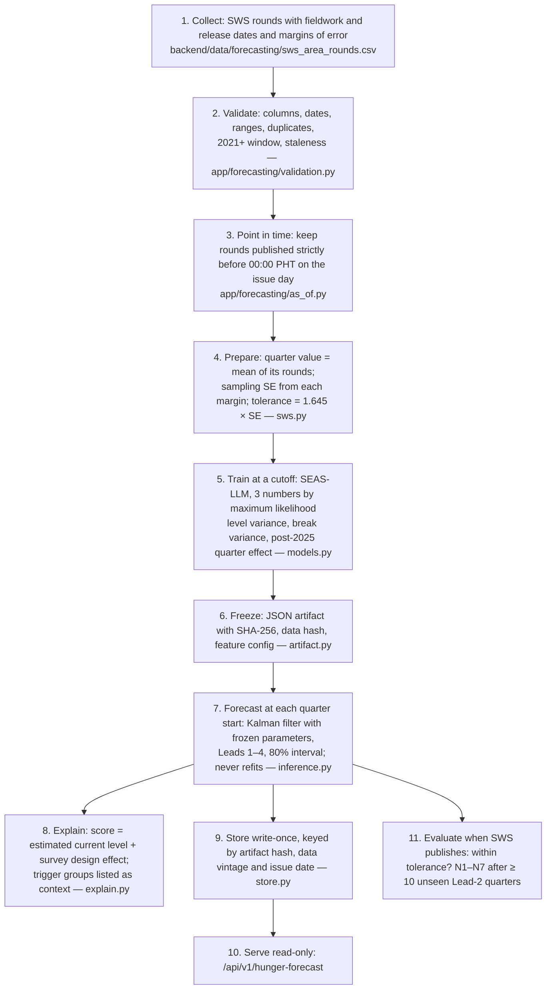

# Methodology

**Scope.** This document describes the numerical hunger-forecasting method implemented in `backend/app/forecasting`. Related documents:
- the served dashboard model (P0H4): `AUDIT.md` §1;
- evidence: `MODEL_REPORT.md`;
- data: `DATA_INVENTORY.md`;
- frozen rules: `PROTOCOL_LOCK.md`.

## What is forecast

**The target:**
- SWS involuntary hunger: the % of families that experienced hunger with nothing to eat in the past three months;
- for the four SWS areas, including **Balance Luzon, which contains CALABARZON**;
- for Leads 1–4: Lead k is the dashboard quarter − 1 + k, and Lead 2 is the next quarter.

**Scoring:**
- the primary tolerance |forecast − SWS| ≤ 1.645 × the quarter's sampling SE;
- the 75 % goal;
- reliability rules N1–N7.

All three are locked (`PROTOCOL_LOCK.md` T1–T4, E1, R1).

**Claim limits.** The method does **not** forecast provincial or LGU food insecurity, because no quarterly provincial measurement exists. Provinces and LGUs show the Balance Luzon value as a *broader-area reference* (`DATA_INVENTORY.md` §3).

## Process

## The model in plain language (SEAS-LLM)

- **Hunger has a true level** that moves a little each quarter (a random walk). Each SWS reading is that level plus survey noise of known size, from the published margin.
- **A Kalman filter** combines past readings, weighting each by its precision, to estimate today's true level.
- **The 2025 respondent change** (household heads → adults, documented by SWS) is allowed one extra level jump.
- **After that change,** a small quarter-of-year effect is learned from past data and shrunk toward zero.
- **The forecast** is the estimated level plus that effect. Its interval widens with the horizon.
- **Parameters:** only three numbers are estimated.

## Why this model, and what the evidence says

- **The pre-declared rule** (`SELECTION_RULE.md`, applied in `MODEL_REPORT.md`) selects **persistence** (the latest reading). No candidate, including SEAS-LLM and the five-driver HFM-X, beats it with a 95 % CI above zero on the 10 target quarters available.
- **SEAS-LLM is served** by the new endpoint because the owner approved it as the prospective primary (E134 Addendum 2). The persistence value (each record's latest reading) is visible alongside it.
- **No lead is reliable.** The Lead-2 blockers are listed in `MODEL_REPORT.md` §6.
- **Learned models** (ridge, LightGBM) overfit on about 40–100 rows and lose to persistence. They are not used.
- **The five trigger groups** (market, climate, employment and OFW, news and NLP, poverty and vulnerability) stay identifiable and are shown as **context**. No group has a demonstrated Lead-2 contribution in chronological ablation (E133–E136), and no group is weighted by hand.

## What would change the conclusion

- ≥ 10 unseen Lead-2 quarters scored prospectively (from SWS 2026-Q4).
- A leading indicator of hunger *change* at SWS-area level; regional quarterly LFS is the main untested candidate.
- A provincial food-insecurity measurement (for example CBMS FIES) for any provincial claim.
