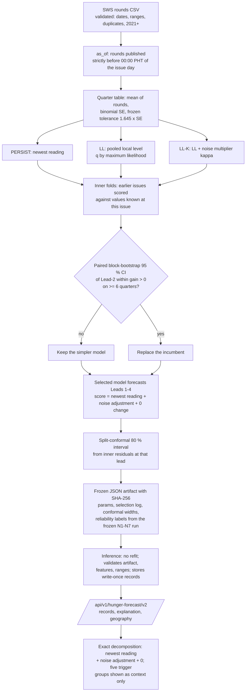

# v2 Methodology (one page)

**What is forecast:** SWS involuntary hunger, % of families, for the 4 SWS areas, at Leads 1–4 from each quarter-start issue. CALABARZON lies in **Balance Luzon**. Target, tolerance, leads and reliability rules are the frozen ones (`../PROTOCOL_LOCK.md`).

**Why it looks like this:** see `DIAGNOSIS.md`. In short:
- the series is a noisy random walk with one large level shift (2024);
- no economic, climate, labour, news or poverty indicator held predicts its change;
- even perfect knowledge of today's true level reaches only about 43 % within tolerance at Lead 2.

So the only part worth modelling is **how much of the newest reading is survey noise**.

## The method in plain language

1. **Take only what was public.** On the first day of a quarter, use every SWS round published before midnight (Manila time) of that day, and nothing else.
2. **Start from the newest reading.** It is the strongest known predictor (the "anchor").
3. **Optionally remove sampling noise from it.** A local-level model weighs the newest reading against the earlier readings, using each round's published margin of error.
   - **LL** uses the binomial survey error.
   - **LL-K** also estimates how much larger the real survey noise is.
   - Their parameters are shared across the 4 SWS areas, because the areas' dynamics do not differ significantly (Q5).
4. **Predict no further change.** Nothing available forecasts the change (Q3).
5. **Choose between "newest reading as is" and "denoised" by a fixed rule.** At each issue the earlier forecasts are scored against what was known by then. A more complex option replaces the simpler one only if its advantage within tolerance has a 95 % confidence interval entirely above zero over ≥ 6 earlier target quarters.
6. **Put an honest interval around it.** The 80 % interval comes from the sizes of past errors at that lead (split-conformal), not from a model assumption.
7. **Label everything.** Each number shows:
   - its evidence status (an SWS area value; provinces and LGUs are not measured);
   - its reliability status, computed by code from the frozen rules;
   - a plain-language limitation.

**What the rule chose:** **persistence**, at every one of 22 issues (2021-Q3 … 2026-Q4). The served forecast is therefore "**last observed value carried forward**", with an empirical interval.



## What the method does not do, and why

| Not done | Reason |
|---|---|
| Forecast a change from prices, climate, jobs, news or poverty | No repeatable leading signal (DIAGNOSIS Q3). They are shown as **context** with their values and dates, never as weights. |
| Seasonal, trend or mean-reversion terms | Not supported (Q2): Kruskal p ≥ 0.44; no momentum; mean reversion gives zero out-of-sample gain |
| Provincial or LGU hunger values | No provincial measurement exists. Provinces and LGUs carry the Balance Luzon value only as a labelled **broader-area reference**; their own estimate is `null` / `AWAITING_GROUND_TRUTH`. |
| Claim 75 % or a reliable Lead 2 | Development result: 40 % at Lead 2. The rules are re-applied only on unseen quarters (sealed set = future quarters from 2026-Q4). |

## Reproduce

All from the repository root, backend venv:

```
python -I backend/scripts/v2_diagnosis.py
python -I backend/scripts/v2_validate.py
python -I backend/scripts/v2_score_sealed.py
python -I backend/scripts/v2_context.py 2026-10-01
python -I backend/scripts/v2_e2e.py
```

- The seal (`v2_seal.py`) and the artifact build are write-once; the E2E run rebuilds both in a temporary directory and compares hashes.
- **Details:** `PREREGISTRATION.md` (rules, fixed before fitting), `MODEL_REPORT_V2.md` (results), `DEVIATIONS.md`.
