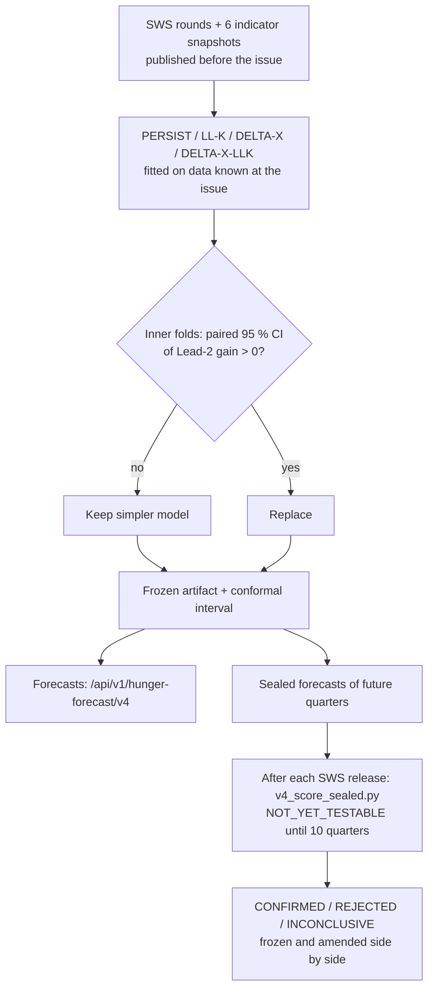

# v4 Methodology (plain language)

**Goal:** forecast actual food insecurity, measured as SWS involuntary hunger (% of families, 4 SWS areas; CALABARZON lies in Balance Luzon), two quarters ahead. Then test credibly whether the system reaches ≥ 75 % within tolerance and beats every other model.

**Why v4 changes so little in the forecast itself:**
- Prices, climate, jobs, news and poverty were each allowed to enter, under a pre-declared stability rule, and none helped (MODEL_REPORT_V4 §1).
- The rule therefore kept the newest SWS reading carried forward (persistence).

**What v4 adds:**
- the test design that can confirm or reject the claims honestly;
- the machinery to run that test as SWS publishes new quarters.

## Steps

1. **Only public information.** At 00:00 Manila time on the first day of a quarter, use SWS rounds published before that moment (`as_of`), plus frozen point-in-time snapshots of 6 indicators from the five groups, each published before that moment.
2. **Four candidates, simplest first:**
   - the newest reading (PERSIST);
   - a denoised newest reading (LL-K);
   - the newest reading plus a change predicted from the indicators (DELTA-X);
   - the denoised reading plus that change (DELTA-X-LLK).
3. **Indicators must earn their place, in the fold.** An indicator is used only if, on data already scored by then:
   - it correlated with later hunger change (|ρ| ≥ 0.30) in ≥ 6 earlier issues;
   - and the sign was the same in the earlier and later halves.

   Weights are learned (ridge), never set by hand. There is no bias correction.
4. **Pick by a fixed rule.** A more complex candidate replaces a simpler one only if its advantage on earlier quarters has a 95 % CI entirely above zero.
5. **Honest interval:** an 80 % interval from the size of past errors at that lead.
6. **Three separate tiers:**
   - **TRAIN:** early rows;
   - **DEVELOPMENT-TEST:** the 2024–26 rows, already seen, non-confirmatory;
   - **SEALED:** future SWS quarters only, forecast in advance and hashed.
7. **Mechanical verdicts.** On sealed quarters, once there are ≥ 10 quarters / 40 rows:
   - **75 % claim:** CONFIRMED if the one-sided 95 % lower bound is ≥ 0.75; REJECTED if the upper bound is < 0.75; otherwise INCONCLUSIVE.
   - **"Beats all":** every baseline beaten with a Holm-corrected p < 0.05.
   - Both the frozen tolerance and (if your adviser signs it) the published-margin tolerance are reported side by side.
8. **Serve and explain.** The selected model's frozen artifact produces each forecast without retraining. Each forecast carries:
   - its decomposition: newest reading + noise adjustment + change by group, summing exactly to the score;
   - the five-group values at the issue date;
   - computed statuses;
   - a limitation sentence.

   Provinces and LGUs show the Balance Luzon value only as a labelled broader-area reference; their own estimates are `null` until measured.

**Details:**
- **Rules:** PREREGISTRATION.md;
- **Tiers and n:** EVALUATION_DESIGN.md;
- **Data options:** TARGET_OPTIONS.md;
- **Results:** MODEL_REPORT_V4.md.
