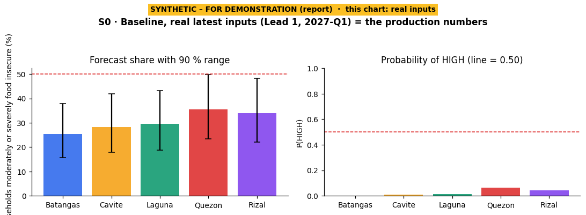
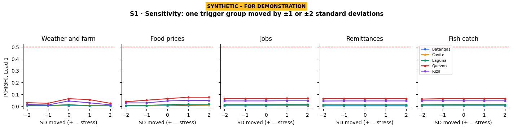
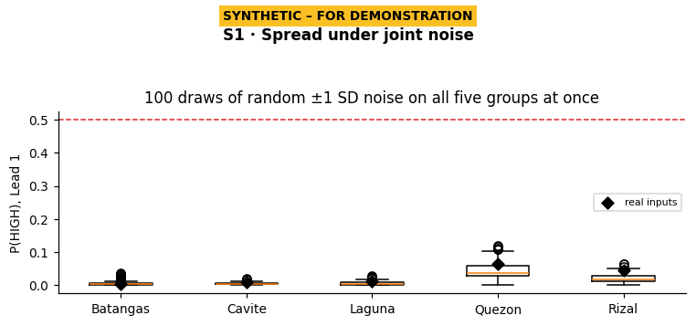
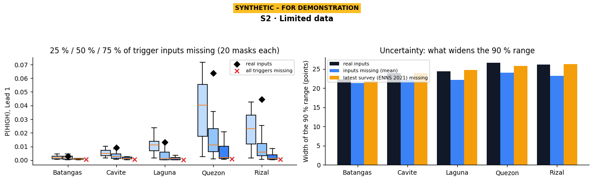
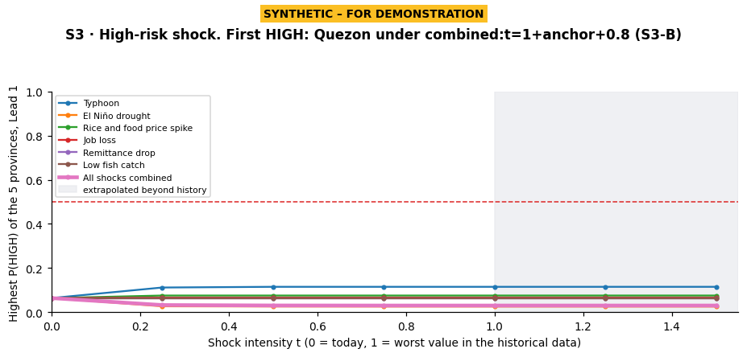
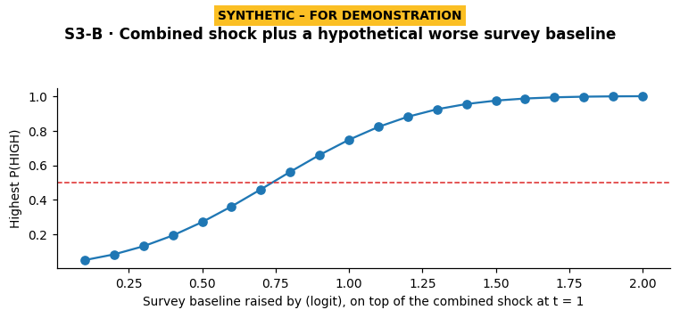
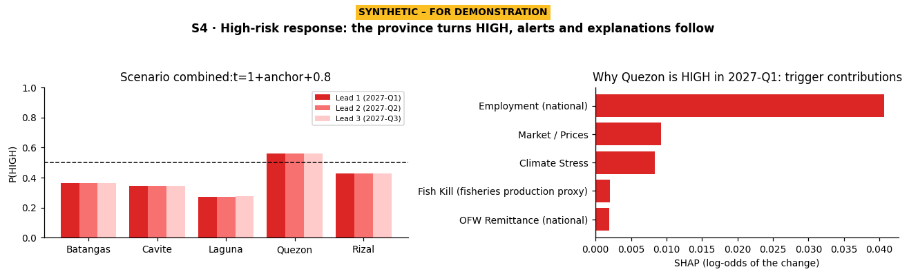
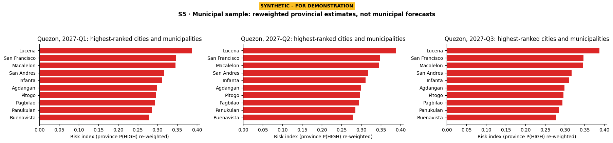

# E178 Part A: scenario test report

> **SYNTHETIC – FOR DEMONSTRATION.** Everything below except S0 uses made-up inputs. These are demonstrations of how
> aiPHeed responds, not forecasts and not validation evidence. The public dashboard and the real outlook are unchanged.

**What was done.** The approved E168 forecast in production (issue `2026-Q4_2026-11-01`, data published before
1 November 2026) was re-run with the **frozen E168 procedure** (`app.e168.serve._forecast`, unchanged). Copies of the
five provinces' input rows were then changed according to the scenarios fixed in advance in `docs/e178/PROTOCOL.md`. The
model, its settings and its training data are E168's. Only the inputs of the forecast rows were changed.

- **Reproduce:** `cd backend; python -m app.e178.scenarios run`, then `python -m app.e178.scenarios charts`.
- **Run time:** 31 minutes.
- **Files:** `backend/data/e178/synthetic/` (every synthetic row labelled `is_synthetic`, `scenario_id`,
  `generator_seed`), with SHA-256 hashes in `hashes.json` and a run log in `run_log.jsonl`.
- **In the system:** Admin menu → Presentation → **Scenario / Demo mode** (off by default; admin and demo accounts only).

## Summary for the panel

| | What we changed | What happened |
|---|---|---|
| **S0** | Nothing (real inputs) | Identical to the dashboard: all five provinces LOW. Quezon is highest at P(HIGH) 0.064. |
| **S1** | One input group moved by ±1 or ±2 standard deviations | P(HIGH) moved by at most ±0.04. No province came near HIGH. The forecast is stable to ordinary noise. |
| **S2** | 25–75 % of inputs removed, or the 2021 survey removed | Forecasts went **down**, and the 90 % range did **not** widen. The system gives **no warning**. |
| **S3** | Severe shocks up to the worst values on record and beyond | **No shock turned a province HIGH.** The largest effect was a typhoon shock (Quezon 0.064 → 0.115). Beyond the historical range nothing changes. |
| **S3-B** | Combined shock plus a hypothetically worse latest survey | Quezon turns HIGH (P = 0.56) once its survey baseline is raised from about 33 % to about 52 %. |
| **S4** | The HIGH result above | 3 early-warning alert candidates, staged for DA review. Explanations, ranking and report text follow automatically. Nothing is published without an administrator. |
| **S5** | The same HIGH result | Quezon's cities and municipalities ranked. Lucena, San Francisco and Macalelon come first. These are reweighted provincial estimates. |

**The main lesson:** E168's forecast is anchored on the latest provincial survey. The five trigger groups adjust it only
slightly. A province turns HIGH when its survey level is near 50 %, not because of a short-term shock alone.

---

## S0 · Baseline (real latest inputs)

| Province | 2027-Q1 share food insecure | 90 % range | P(HIGH) | Class |
|---|---|---|---|---|
| Batangas | 25.3 % | 15.7–38.0 % | 0.003 | LOW |
| Cavite | 28.3 % | 17.9–41.8 % | 0.009 | LOW |
| Laguna | 29.5 % | 18.8–43.1 % | 0.013 | LOW |
| Quezon | 35.5 % | 23.3–49.9 % | 0.064 | LOW |
| Rizal | 33.9 % | 22.1–48.2 % | 0.044 | LOW |

**What happens with the real inputs?** The procedure reproduces the production issue **exactly**. All 15 province × lead
rows (Leads 1–3) match on score, range, probability, class and configuration
(`RSS|FULL|prune=False|leaves=3,minchild=10,lambda=20.0,trees=400|cal=raw`). Every SHAP column on the dashboard matches
too. This check ran before any scenario file was written (`run_log.jsonl`, event `S0_check`: equal). Leads 2 and 3 give
almost the same numbers, because the trigger inputs are those of the issue date.

## S1 · Perturbation / sensitivity

Quezon, the highest-risk province, at Lead 1 (P(HIGH); real inputs = 0.064):

| Group moved | −2 SD | −1 SD | +1 SD | +2 SD |
|---|---|---|---|---|
| Weather and farm | 0.030 | 0.024 | 0.055 | 0.025 |
| Food prices | 0.038 | 0.050 | 0.076 | 0.075 |
| Jobs | 0.064 | 0.064 | 0.066 | 0.066 |
| Remittances | 0.064 | 0.064 | 0.064 | 0.064 |
| Fish catch | 0.060 | 0.064 | 0.064 | 0.064 |

Then 100 random draws moved all five groups together by about one standard deviation each. Across those draws, Quezon
ranged from 0.002 to 0.119, Rizal reached at most 0.065, and the other three stayed below 0.04. **No draw produced a HIGH
province.**

**What happens when the inputs move a little?** Very little. The forecast is stable. Food prices act in the expected
direction: higher prices give a higher risk. Jobs, remittances and fish catch barely move it. Weather and farm is not
monotone: moving it "toward stress" can *lower* risk. Its rainfall, soil-moisture and El Niño inputs are the only
trigger inputs E168 leaves unconstrained, and the model learned that drier-than-usual readings went with smaller
increases in food insecurity in the survey years (see S3).

## S2 · Limited data

Mean P(HIGH) at Lead 1, over 20 random masks each:

| Province | Real | 25 % missing | 50 % missing | 75 % missing | All triggers missing | 2021 survey missing |
|---|---|---|---|---|---|---|
| Batangas | 0.003 | 0.002 | 0.002 | 0.001 | 0.001 | 0.015 |
| Cavite | 0.009 | 0.006 | 0.004 | 0.002 | 0.000 | 0.036 |
| Laguna | 0.013 | 0.011 | 0.004 | 0.002 | 0.000 | 0.053 |
| Quezon | 0.064 | 0.037 | 0.013 | 0.010 | 0.001 | 0.086 |
| Rizal | 0.044 | 0.023 | 0.008 | 0.003 | 0.000 | 0.102 |

With all triggers missing, Quezon's forecast share falls from 35.5 % to 22.7 %. Width of the 90 % range at Lead 1
(points): real 22–27; with inputs missing 21–25; with the 2021 survey missing 22–26.

**What happens when data is missing?** Three findings, reported as found:

1. **Missing inputs push the forecast down.** LightGBM does not treat a missing input as "unknown". It follows a fixed
   default branch: for an input that was never missing in training, the value is read as zero, which for most inputs
   means "no change". So missing data looks like calm conditions. **Missing data is not evidence of low risk**, but the
   model treats it that way.
2. **The 90 % range does not widen.** The range is set by how old the latest survey is (`gap_q`), not by how many inputs
   are present. In percentage points it even narrows slightly, because the forecast moves away from 50 %.
3. **The system does not warn.** The forecast rows have no field for missing inputs. The only stop is the release
   check (`app.e168.regenerate._check_fresh`), which refuses to stage an issue when the provincial panel ends more than
   two quarters before the issue. The "Latest data used" list on the dashboard describes the real sources only.

**Latest survey round missing.** Among the five provinces, ENNS 2021 covers only Batangas and Cavite. Laguna, Quezon and
Rizal's latest survey is 2019. Removing 2021:

- Batangas' and Cavite's survey age rises from 22 to 46 quarters.
- The model is refitted on 532 instead of 732 training rows and selects a different configuration
  (`RSS|FULL|prune=True|…|trees=150`). That is why all five probabilities change slightly upward.
- The ranges do not widen, because the refitted model's uncertainty scale is fitted on different errors.
- A limitation: the precomputed survey-history signal (`h2`) is unchanged in this case.

**Recommendation (not implemented):** add a missing-input count and a "data incomplete" flag to each forecast row, and
raise the 90 % range when inputs are missing.

## S3 · High-risk shock

Each shock moves the affected inputs from today's value toward the **worst value in the historical data** (t = 1) and
beyond it (t = 1.25 and 1.5, flagged as extrapolated). It hits all five provinces at once. The table gives the highest
P(HIGH) among the five provinces at Lead 1:

| Shock | t = 0.25 | 0.5 | 1.0 (worst on record) | 1.5 (extrapolated) |
|---|---|---|---|---|
| Typhoon (more typhoons, smaller harvest) | 0.112 | 0.115 | 0.115 | 0.115 |
| Rice and food price spike | 0.075 | 0.075 | 0.075 | 0.075 |
| Job loss | 0.066 | 0.066 | 0.066 | 0.066 |
| Remittance drop | 0.064 | 0.064 | 0.064 | 0.064 |
| Low fish catch | 0.064 | 0.064 | 0.064 | 0.064 |
| El Niño drought | 0.026 | 0.026 | 0.025 | 0.025 |
| All shocks combined | 0.032 | 0.030 | 0.030 | 0.030 |

**What happens under a severe shock?** **No shock, alone or combined, made any province HIGH.**

- The constrained E168 change model, chosen because flexible models overfit, can move a forecast only a few points. The
  largest move was +2.9 points: Quezon from 35.5 % to 38.4 % under the typhoon shock.
- Beyond the historical range nothing changes. Trees cannot extrapolate, so the curves are flat after t ≈ 0.5.
- The combined shock is *weaker* than the typhoon shock alone. Its El Niño and drought part lowers the forecast,
  because those inputs are unconstrained and the model learned the opposite of the drought expectation (see S1).

## S3-B · Combined shock plus a hypothetical worse survey

Because S3 produced no HIGH, the protocol's fallback was used. The combined shock at t = 1 was kept, and the survey
baseline (the anchor the forecast starts from) was raised in steps of 0.1 logit.

| Baseline raised by (logit) | 0.2 | 0.4 | 0.6 | 0.7 | **0.8** | 1.0 | 1.5 |
|---|---|---|---|---|---|---|---|
| Highest P(HIGH) | 0.085 | 0.194 | 0.362 | 0.461 | **0.562** | 0.748 | 0.974 |

At **+0.8 logit**, Quezon turns HIGH (P = 0.562; forecast share 51.5 %, 90 % range 37.0–65.8 %), at Leads 1–3. This
raises Quezon's survey baseline from 32.9 % to about 52.1 %. In plain words: **if Quezon's latest survey had shown
about 52 % of households moderately or severely food insecure instead of about 33 %, and the worst recorded conditions
held, E168 would flag Quezon HIGH.** The other provinces stay LOW (Rizal 0.43, Batangas 0.36, Cavite 0.35, Laguna 0.27).
This variant feeds S4 and S5.

## S4 · High-risk response

The S3-B rows were passed, inside the offline scenario process only, through the same functions the live system uses.
Nothing was written to the database, the registry or any E168 file.

**1. Early-warning alerts** (`app.quarterly.alerts_e168`). There are **3 candidates**: Quezon for 2027-Q1, Q2 and Q3, rule
`E168_HIGH` (P(HIGH) ≥ 0.50 at a lead the acceptance rule covers), with evidence P = 0.562 and share 51.5 %. Each carries
the statement: *"Model-generated early-warning candidate (E168 food-insecurity forecast) for review by DA Region IV-A.
Not an official food-insecurity classification and not a confirmed emergency."*

**2. Admin review flow.**

1. A candidate is **staged** and never published automatically.
2. A DA Region IV-A administrator opens **Admin → Review** and either **confirms** it
   (`POST /api/v1/admin/alerts/{id}/confirm`) or **dismisses** it (`POST /api/v1/admin/alerts/{id}/dismiss`).
3. Only a confirmed alert reaches the public dashboard (`GET /api/v1/alerts`). A dismissed one stays in the records for
   audit.
4. The demo account can view the queue but cannot confirm or dismiss.

**3. Ranking (2027-Q1).**

| Rank | Province | P(HIGH) | Band |
|---|---|---|---|
| 1 | Quezon | 0.562 | High |
| 2 | Rizal | 0.428 | Low |
| 3 | Batangas | 0.364 | Low |
| 4 | Cavite | 0.345 | Low |
| 5 | Laguna | 0.272 | Low |

**4. Explanation (SHAP and plain language).** The dashboard sentence reads: *"Quezon, 2027-Q1: HIGH food-insecurity risk
(probability 0.56). Lead-1 forecast: meets the acceptance rule (accuracy 0.750 on 72 past provincial forecasts; latest
survey alone 0.625); … forecast HFIAS moderate+severe 51.5% (90% range 37.0-65.8%)."*

- The largest trigger contribution is national employment (+0.041 log-odds), then market and prices (+0.009) and
  climate (+0.008).
- The survey baseline and other inputs account for 76 % of the attribution.
- The plain-language driver text quotes the **scenario's** input values against real calendar periods, for example
  "Unemployment in the whole country was 17.6% in September 2026". It is shown only inside the SYNTHETIC-labelled demo.

**5. Report text** (`app.services.report_data.build_report`, the PDF report's wording). *"For Quezon in 2027 Q1, the SHAP
decomposition assigns the largest share of the attributed model output among the 5 driver groups to Employment
(national) (16%), which increases the predicted Risk Level score…"* The report's news section uses the real news archive,
which the scenario does not change.

**What does the system do when a province turns HIGH?** It does what the thesis design requires:

- The province is coloured HIGH and ranked first.
- An explanation names the drivers.
- An alert is **staged for a human decision**, never sent automatically.

## S5 · Municipal high-risk sample

Quezon at Lead 1 (2027-Q1), using the dashboard's own municipal disaggregation (`app.services.dashboard.municipality_summary`):

| Rank | City / municipality | Index | Poverty incidence | Population |
|---|---|---|---|---|
| 1 | Lucena | 0.388 | — (no PSA municipal estimate; province substitute) | 280,331 |
| 2 | San Francisco | 0.348 | 30.2 % | 63,789 |
| 3 | Macalelon | 0.346 | 30.1 % | 25,266 |
| 4 | San Andres | 0.317 | 27.8 % | 38,407 |
| 5 | Infanta | 0.311 | 27.3 % | 77,676 |
| 6 | Agdangan | 0.299 | 25.5 % | 13,316 |
| 7 | Pitogo | 0.297 | 25.9 % | 22,499 |
| 8 | Pagbilao | 0.294 | 24.9 % | 82,132 |
| 9 | Panukulan | 0.286 | 26.0 % | 17,118 |
| 10 | Buenavista | 0.279 | 25.0 % | 31,550 |

**Which towns come out highest in a HIGH province?** These are **reweighted provincial estimates, not municipal
forecasts**. Each index is Quezon's P(HIGH) re-weighted by PSA poverty incidence (60 %) and population density (40 %), as
Objective 3 specifies. Every town in a HIGH province is coloured HIGH, and the number orders them within the province.
Lucena ranks first on density. It has no PSA municipal poverty estimate, so a province value stands in for it, which
the dashboard says.

---

## Limits of this demonstration
- **Scope.** The scenarios change the forecast rows' inputs only. The model stays the one trained on real data (except
  the "2021 survey missing" case, which refits it without that round).
- **Stress directions.** The direction of stress for the unsigned climate inputs (ONI, rainfall and soil anomalies) was
  set by us (El Niño and drought). The model does not share that direction.
- **S3-B baseline.** The baseline is raised directly. It is not a re-estimated survey.
- **Provenance.** Two gitignored inputs were supplied by the owner and hash-checked against their locks (PSA regional
  consumption; ENNS 2021 labels). The SunStar headline panel was replaced by an empty panel with the same columns. E168
  uses none of its columns, and S0's exact match confirms it.
