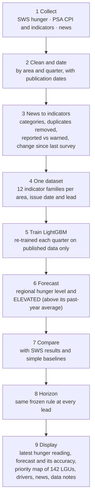

# aiPHeed final methodology (simple version)

**aiPHeed: a geospatial food-insecurity forecasting system for DA Region IV-A using NLP and machine learning**

**Coverage:** Cavite, Laguna, Batangas, Rizal and Quezon, with 142 cities and municipalities.

**Study period:** 2021 onward.

## Workflow



## Steps

| # | Step | What happens | Where in the code |
|---|---|---|---|
| 1 | Collect | <ul><li>SWS involuntary hunger: 23 rounds, 2021–2026, for 4 areas.</li><li>PSA provincial CPI (food and all items).</li><li>The other indicator sources: rice, poverty, population, palay/corn, fisheries, LFS, BSP remittances, PAGASA El Niño, IBTrACS typhoons.</li><li>About 9,700 CALABARZON news headlines and 58,600 GDELT documents.</li></ul> | `aipheed-backend-aligned/experiments/FINAL_FOOD_INSECURITY_LIGHTGBM/data/`; `backend/data/` |
| 2 | Clean and date | Every value keeps the date it became public. A forecast issued on date O uses only what was published before O. | `fi_lib.known`, `fi_lib.row_features` |
| 3 | News to indicators | <ol><li>Tag each headline with one of 6 food-related event types: prices, shortage, disaster, crops and supply, jobs and income, assistance.</li><li>Remove repeated stories about one event.</li><li>Mark forward-looking headlines ("possible future risk") apart from reports of events that already happened.</li><li>Measure how each type changed since the last survey, compared with a year earlier.</li></ol> | `news_features.py`; `app/services/final_engine.news_kind` |
| 4 | One dataset | For each SWS area, issue date and lead (0–4 quarters), the 12 families are placed side by side. A missing value stays missing; it is never set to zero. | `fi_lib.panel` + `oa_lib.row_features` |
| 5 | Train LightGBM | One model is re-trained at each issue date on all earlier rows whose outcome was already published. It learns the **change from the latest SWS reading**. | `fi_lib.fil_forecasts`, `oa_lib.training` |
| 6 | Forecast | <ul><li>Next hunger level = latest reading + predicted change.</li><li>ELEVATED (yes/no) = forecast level above the past-year average.</li></ul> | same |
| 7 | Compare | Accuracy, balanced accuracy, precision, recall, F1, AUC, MAE and RMSE against the latest reading, a moving average, climatology, logistic regression, PSA-only and NLP-only, on the same rows. Leakage is checked by changing future data and confirming no forecast changes. | `fi_lib.decide`, `run_oa.py audit/score` |
| 8 | Horizon | The same frozen rule at every lead (accuracy ≥ 0.75 plus 7 checks). The furthest passing lead is the reliable horizon. **None passed.** | `oa_lib.max_reliable_lead` |
| 9 | Display | Described in the table below. | `/api/v1/final/*` and the existing dashboard routes |

**What the dashboard displays (step 9)**
- The latest SWS reading, with survey and publication dates and its age.
- The LightGBM forecast and its tested accuracy.
- The province and LGU **priority score** map (FIRI v2, indicator-based, not a hunger rate).
- What drives each score (SHAP).
- The news, labelled as context.
- The forecast archive.
- The data-quality notes.

## The three kinds of number the system shows

| Kind | Level | Source | What it is | What it is not |
|---|---|---|---|---|
| Regional hunger | SWS area (Balance Luzon contains CALABARZON) | SWS surveys | A measured outcome, and the LightGBM forecast of it | A provincial or municipal figure |
| Food-price squeeze | Province | PSA CPI | Food prices rising faster than general prices (economic access) | Hunger |
| Priority score | Province and 142 LGUs | FIRI v2: 12 indicators; LGUs re-weighted by poverty and density | Where to look first | A probability or a measured food-insecurity rate |

## The 12 indicator families

| Family | Columns |
|---|---|
| A1 Food-price pressure | `A1_food`, `A1_gap`, `A_since` |
| A2 Headline inflation | `A2` |
| A3 Wholesale rice | `A3` |
| V1 Poverty and density | `V1` |
| C1 El Niño alert | `C1` |
| C2 Typhoons | `C2` |
| C3 Palay/corn | `C3` |
| C4 Fisheries | `C4` |
| E1 Unemployment | `E1` |
| E2 Remittances | `E2` |
| N1 News | `N1` (FSSI-v3, XLM-R) + `NG_gap_*` (6 GDELT event types) + `NG_ant` |
| H1 Regional hunger | `H1` + `h_last`, `h_anom`, `h_chg`, `h_age_q` |

Coverage and missingness are in `aipheed-backend-aligned/experiments/FINAL_OBJECTIVE_ACHIEVEMENT/data/feature_map.csv`.

**Five driver groups shown to DA**

| Driver group | Families |
|---|---|
| Market and prices | A1–A3 |
| Climate and food production | C1–C4 |
| Employment and remittances | E1–E2 |
| News | N1 |
| Poverty and vulnerability | V1 |
| Regional hunger history | Reported separately |

## Reproduce

Run from `aipheed-backend-aligned/experiments/FINAL_OBJECTIVE_ACHIEVEMENT/runner`, using the backend venv:

```bash
python run_oa.py all
```

Then export what the backend serves:

```bash
python export_engine.py
```
